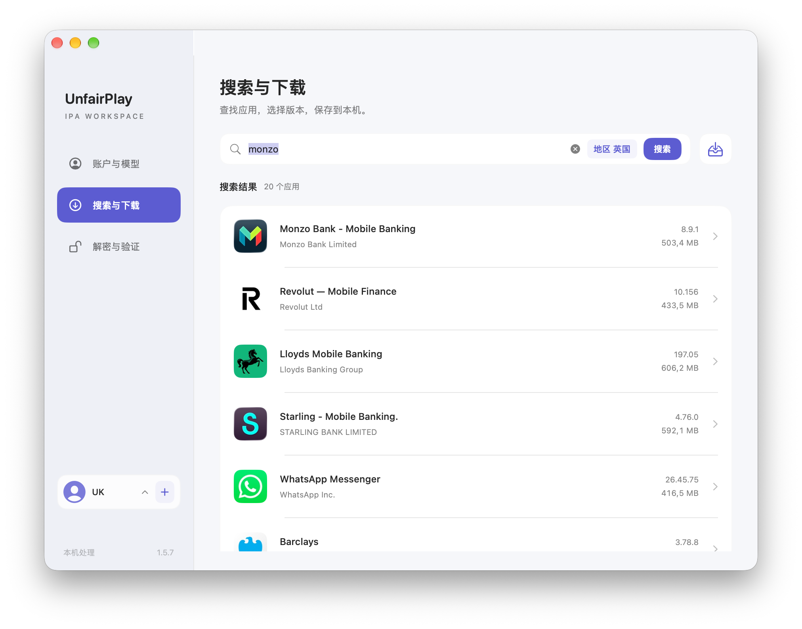
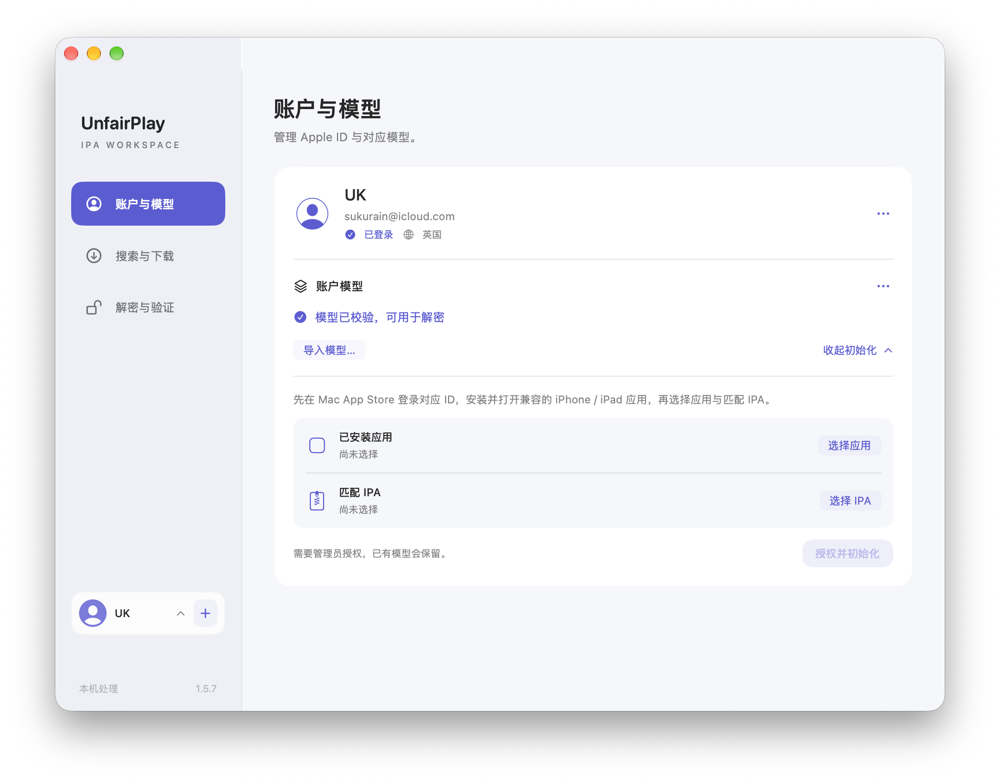
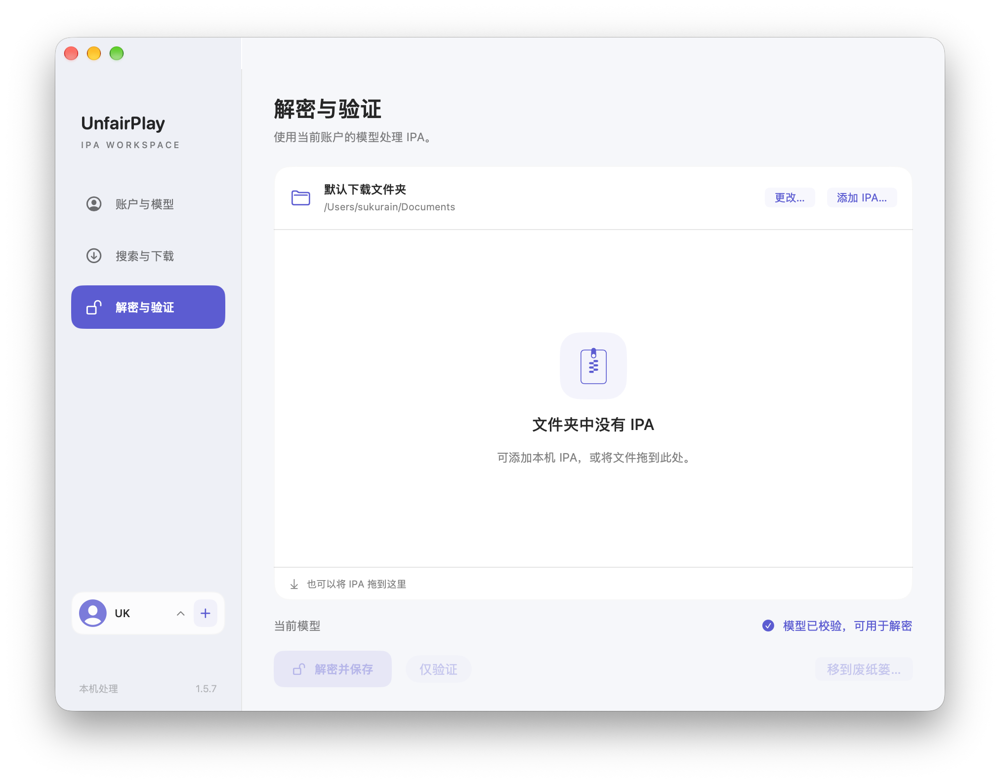

<p align="center">
  
</p>
<h1 align="center">UnfairPlay</h1>
<p align="center">在 Mac 上查找 App Store 应用、下载历史版本，以及在本机解密和验证 IPA。</p>
<p align="center">
  <strong>1.5.8</strong> · Apple 芯片 Mac · 最低部署目标 macOS 14.0
</p>
<p align="center">
  <a href="https://github.com/Emokui/UnfairPlay/releases/latest"><strong>下载最新已发布版本</strong></a>
  · <a href="UnfairPlayDesk/CHANGELOG.md#158">更新说明</a>
  · <a href="#从源码构建">从源码构建</a>
</p>

## 界面预览

### 搜索与下载

切换 App Store 地区，按应用名称、App ID 或链接搜索，再选择可用的历史版本。已下载的 IPA 可在 Finder 中定位或通过 AirDrop 发出。

<p align="center">
  <a href="docs/screenshots/search-and-download.png">
    
  </a>
</p>

| 账户与模型 | 解密与验证 |
| :--- | :--- |
| [](docs/screenshots/account-and-model.png) | [](docs/screenshots/decrypt-and-verify.png) |
| 在独立档案中管理 Apple 账户、商店地区与对应模型。 | 从下载目录选择或拖入 IPA，查看加密状态，再批量解密或验证。 |

## 安装与使用

1. 从 [GitHub Releases](https://github.com/Emokui/UnfairPlay/releases/latest) 下载并打开 DMG，将 **UnfairPlay.app** 拖入 **Applications**。
2. 在「账户与模型」添加 Apple 账户。搜索无需登录，下载使用当前账户的 App Store 许可。
3. 处理本机 IPA 前，在对应账户中导入或初始化模型。模型通过校验后，进入「解密与验证」选择文件。

安装包自带所需工具，默认使用 ad-hoc 签名。各系统的验证范围见 [兼容性说明](UnfairPlayDesk/COMPATIBILITY.md)。

## 从源码构建

需要 Apple 芯片 Mac、Xcode Command Line Tools、Python 3 和 Go 1.26.5 或更新版本。下载源码或克隆仓库后，在仓库根目录运行：

```sh
cd UnfairPlayDesk
./build.sh
```

构建会在仓库根目录生成 `UnfairPlay.app`。在同一项目目录运行 `./test.sh` 可执行回归测试，运行 `./package-dmg.sh` 可生成版本化的安装镜像。

浏览 [界面与辅助工具](UnfairPlayDesk/Sources/)、[测试](UnfairPlayDesk/Tests/) 和 [Go 源码](UnfairPlayDesk/Vendor/)，或查看 [构建参数与 Go 测试说明](UnfairPlayDesk/README.md#编译与测试)。

## 致谢与许可

IPA 处理工具来自 [DrWhax/unfairplay](https://github.com/DrWhax/unfairplay)。账户与下载工具基于 [majd/ipatool](https://github.com/majd/ipatool)。第三方许可及声明见 [Licenses](UnfairPlayDesk/Licenses/) 和各 Vendor 目录。
